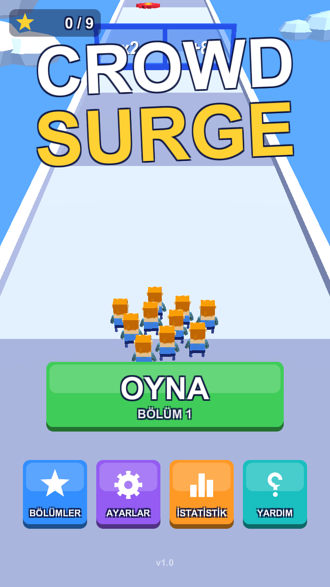
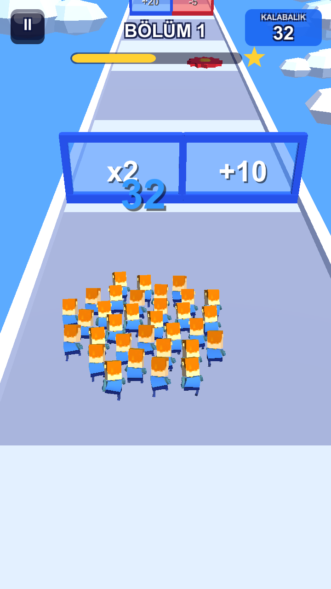
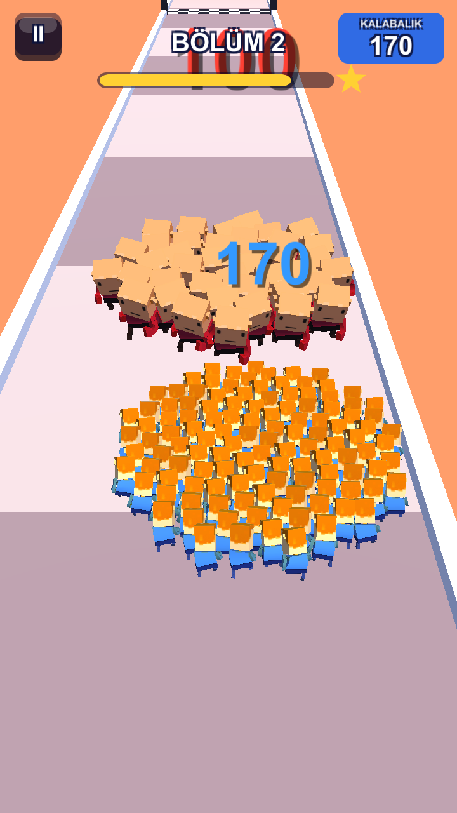
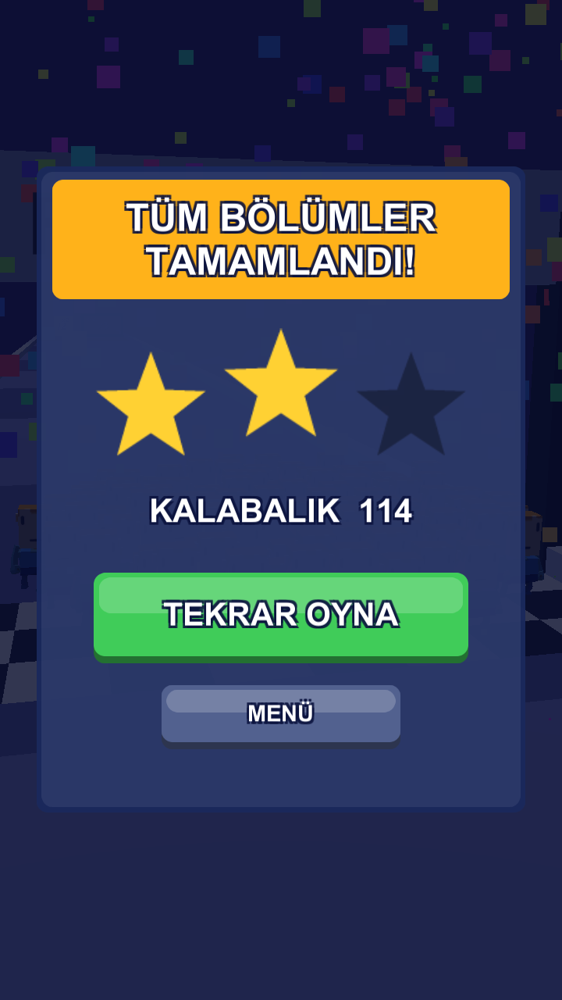
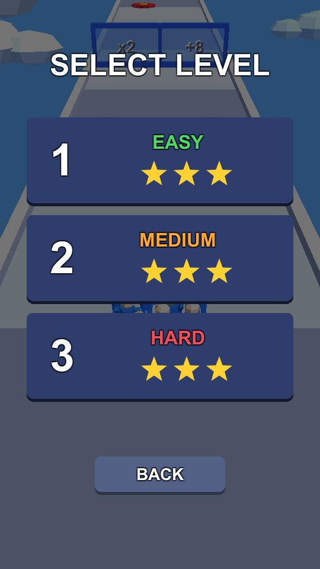
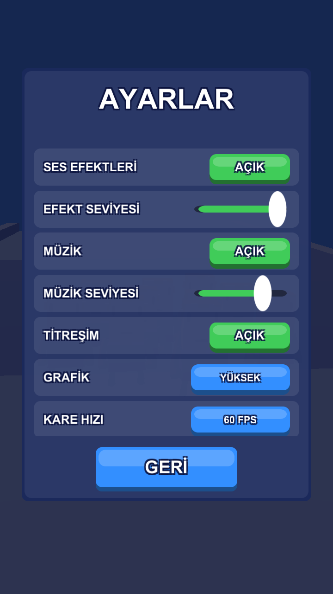
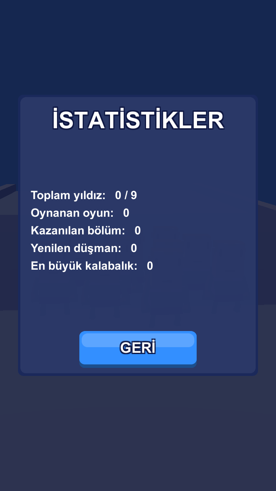
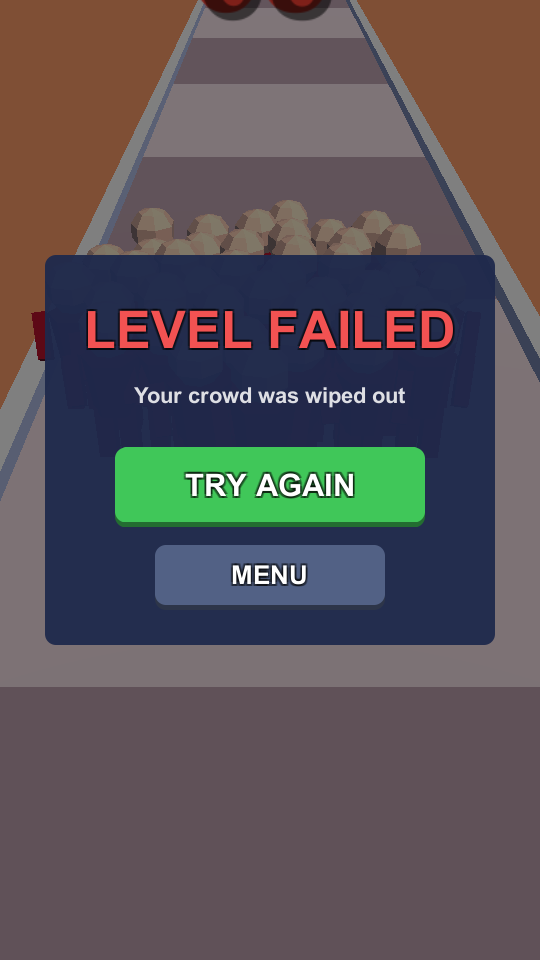
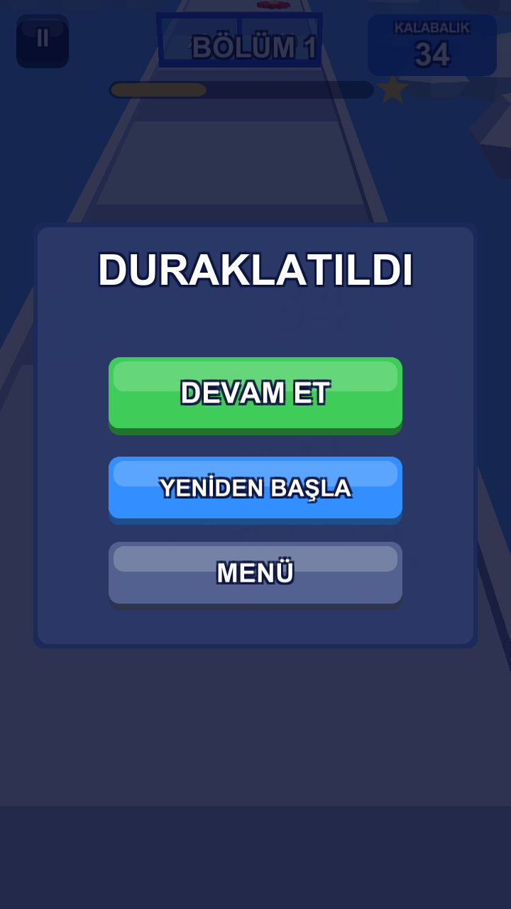

# 👥 Crowd Surge

[🇹🇷 Türkçe](README.tr.md) | **🇬🇧 English**

**A hyper-casual crowd runner for mobile.** Run through gates that add or multiply your crowd, dodge saw blades, fight rival crowds and take down the boss. 3 levels, easy to hard, with a star rating for each.

    

<p align="center">
  
  
  
  
</p>

> **Note:** the in-game UI is **Turkish** only. Code and documentation are in English / Turkish.

## Features

- **3 levels** (easy to hard) with a boss at the end, star rating, level unlocking and saved progress.
- **Gates**, **saw blades**, **rival crowds** and a **boss**; the whole crowd reacts to every hit.
- **Many animated characters, cheaply:** the Cube People run cycle is baked into 8 mesh poses and drawn with GPU instancing (`Graphics.RenderMeshInstanced`) in team-tinted batches.
- **Hyper-casual UI:** candy-style buttons, level select, settings (sound / music / quality / FPS), statistics, help and pause screens, built in code and safe-area aware.
- **Game feel:** hit-stop, camera shake and FOV punch, floating texts, confetti, victory camera swing, haptics.
- **Procedural audio, no audio files:** every effect and the music loop are synthesized at startup (FM bells, marimba, brass, timpani, pads, small room reverb) and loudness-balanced by RMS. Drop your own clips into `Resources/Audio/<SfxName>` to override any sound.
- **Mobile first:** one-finger drag steering, portrait layout, URP mobile renderer.

## Screenshots

| Menu | Levels | Settings | Statistics |
|---|---|---|---|
|  |  |  |  |

| Battle | Victory | Defeat | Pause |
|---|---|---|---|
|  |  |  |  |

## Controls

| Platform | Control |
|---|---|
| Mobile | Drag a finger left / right |
| Editor / PC | Mouse drag, or `A` / `D` / arrow keys |

## Setup

1. Install **Unity 6000.6** (URP 17.6).
2. Clone the repo and open the folder in Unity Hub.
3. Optionally run **CrowdSurge > Bake Characters** (bakes the run animation), then **CrowdSurge > Setup Project** (creates assets and the scene).
4. Press Play. The scene only holds a camera, a light and `GameBootstrap`; everything else is built at runtime.

> The Cube People - Demo pack and a pre-baked `Assets/_Game/Baked/Runner.asset` are included, so the project runs right after opening.

## Project structure

```
Assets/_Game
├─ Scripts
│  ├─ Core      GameManager, GameBootstrap, CameraRig, input
│  ├─ Crowd     CrowdController, Swarm, EnemyManager, formations
│  ├─ Level     TrackBuilder, GateManager, HazardManager
│  ├─ UI        UIManager, UIFactory, UIExtras, generated icons
│  ├─ Audio     SynthClips (procedural), AudioManager
│  ├─ Data      LevelConfig, SaveData, GameAssets, CharacterSet
│  ├─ Util      instanced renderer, particles, floating texts, haptics
│  └─ Editor    Setup, character baker, audio report
├─ Data         Level01-03 (ScriptableObjects)
├─ Baked        baked run animation
└─ Materials / Settings / Resources / Scenes
```

## Customization

- **Levels:** edit `Assets/_Game/Data/Level0X.asset` (gates, hazards, enemies, boss). **CrowdSurge > Reset Level Data** restores the defaults.
- **Sounds:** tweak `SynthClips.cs`, or export previews with **CrowdSurge > Export Audio Preview** (WAVs go to `AudioPreview/`).

## Test tools

- `EditorSmokeTest` is an editor-only bot that plays all three levels and saves screenshots to `Logs/Smoke`.

## Credits and license

- Code: [MIT](LICENSE), (c) Berkay Tonga.
- Characters: **Cube People - Demo** by Fatty War (Unity Asset Store), included in `Assets/CubePeopleDemo`; see its own Readme for terms.
- Audio is generated in code; no third-party audio.
