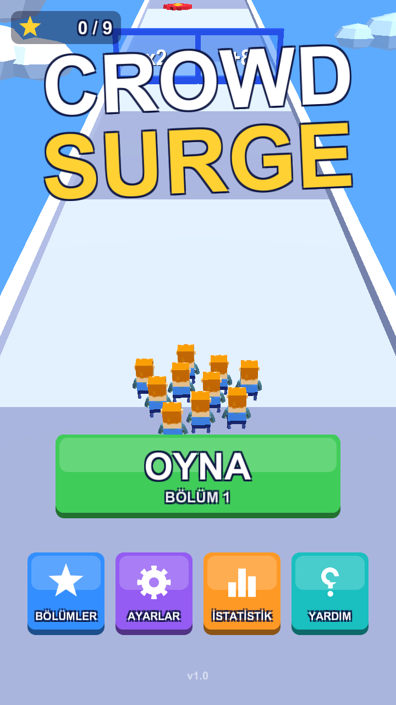
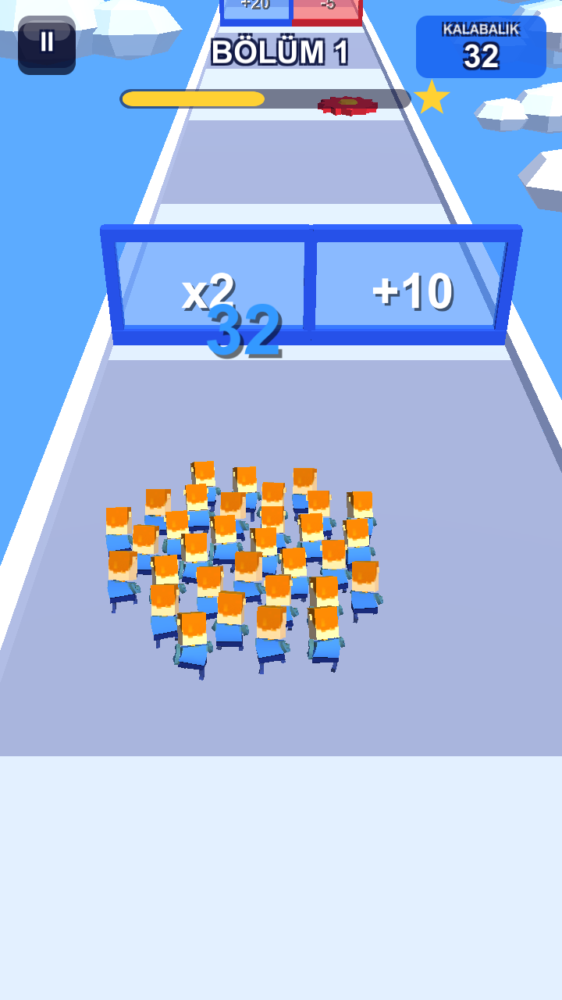
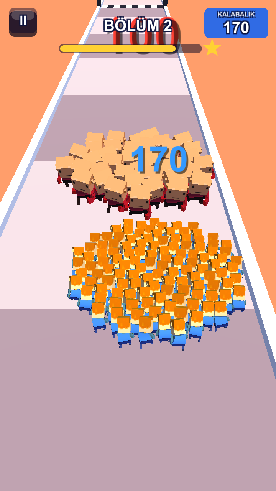
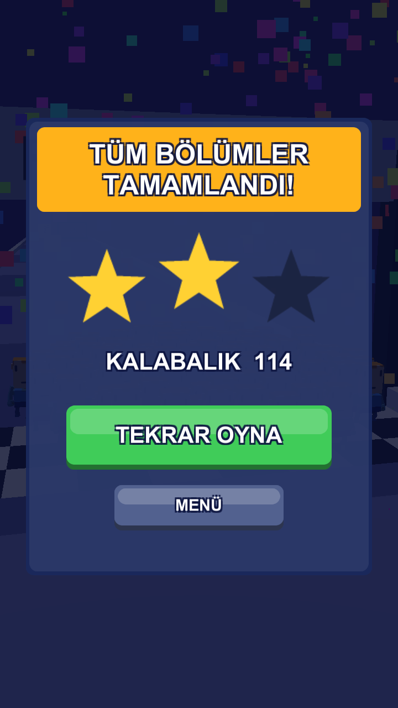
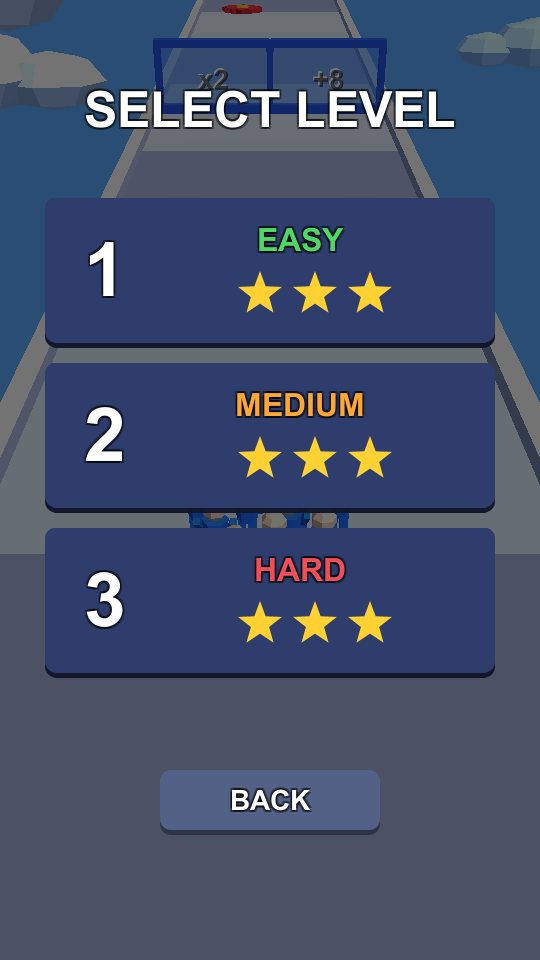
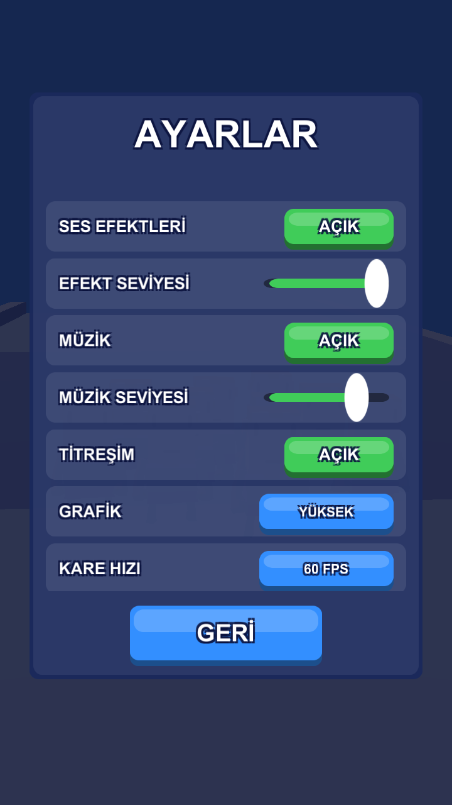
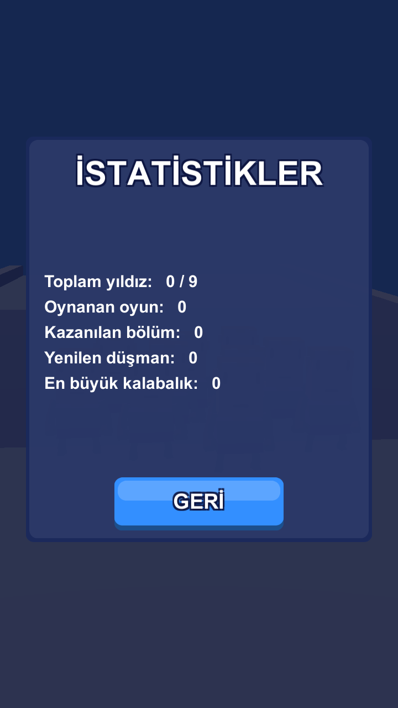
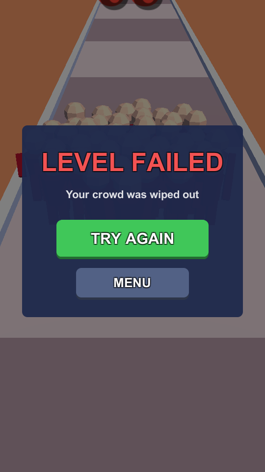
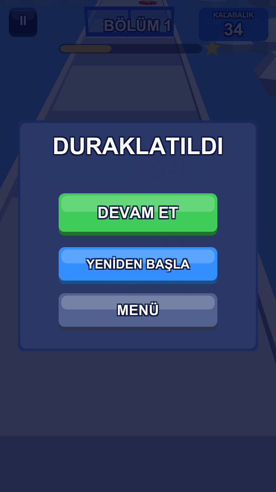

# 👥 Crowd Surge

**🇹🇷 Türkçe** | [🇬🇧 English](README.md)

**Mobil için hyper-casual kalabalık koşu oyunu.** Kalabalığını artıran veya çarpan kapılardan geç, testerelerden kaç, rakip kalabalıklarla savaş ve patronu yen. Kolaydan zora 3 bölüm, her biri için yıldız puanı.

    

  
  
  
  

## Özellikler

- **3 bölüm** (kolaydan zora), sonunda patron, yıldız puanı, bölüm kilidi ve kayıtlı ilerleme.
- **Kapılar**, **testereler**, **rakip kalabalıklar** ve **patron**.
- **Ucuz ama çok sayıda animasyonlu karakter:** Cube People koşu animasyonu 8 mesh pozuna bake edilir ve GPU instancing ile takım renkli gruplar halinde çizilir.
- **Hyper-casual arayüz:** şekerleme tarzı butonlar, bölüm seçimi, ayarlar (ses / müzik / kalite / FPS), istatistik, yardım ve duraklatma ekranları.
- **Oyun hissi:** hit-stop, kamera sarsıntısı, FOV vurgusu, uçan yazılar, konfeti, zafer kamerası, titreşim.
- **Ses dosyası yok, her şey kodla üretilir:** efektler ve müzik açılışta sentezlenir (FM çanlar, marimba, nefesli, timpani, pad, küçük oda yankısı) ve RMS'e göre dengelenir. Kendi sesini `Resources/Audio/<SesAdı>` içine koyarak değiştirebilirsin.
- **Mobil öncelikli:** tek parmakla sürükleyerek kontrol, dikey ekran, URP mobil renderer.

## Ekran görüntüleri

| Menü | Bölümler | Ayarlar | İstatistik |
|---|---|---|---|
|  |  |  |  |

| Savaş | Zafer | Yenilgi | Duraklat |
|---|---|---|---|
|  |  |  |  |

## Kontroller

| Platform | Kontrol |
|---|---|
| Mobil | Parmağı sağa / sola sürükle |
| Editör / PC | Fare ile sürükle veya `A` / `D` / ok tuşları |

## Kurulum

1. **Unity 6000.6** (URP 17.6) kur.
2. Depoyu klonla, Unity Hub ile klasörü aç.
3. İstersen **CrowdSurge > Bake Characters**, ardından **CrowdSurge > Setup Project** menülerini çalıştır.
4. Play'e bas. Sahnede sadece kamera, ışık ve `GameBootstrap` vardır; gerisi çalışma anında kurulur.

> Cube People - Demo paketi ve hazır bake edilmiş `Assets/_Game/Baked/Runner.asset` depoda mevcut; proje açılır açılmaz çalışır.

## Özelleştirme

- **Bölümler:** `Assets/_Game/Data/Level0X.asset` dosyalarını düzenle. **CrowdSurge > Reset Level Data** varsayılanlara döndürür.
- **Sesler:** `SynthClips.cs` dosyasını düzenle veya **CrowdSurge > Export Audio Preview** ile WAV önizlemesi al.

## Test aracı

- `EditorSmokeTest`: sadece editörde çalışan, 3 bölümü de oynayıp `Logs/Smoke` içine ekran görüntüsü alan bot.

## Kaynaklar ve lisans

- Kod: [MIT](LICENSE), (c) Berkay Tonga.
- Karakterler: Fatty War'un **Cube People - Demo** paketi (Unity Asset Store), `Assets/CubePeopleDemo` içinde mevcut; koşulları için kendi Readme dosyasına bakın.
- Ses tamamen kodla üretilir; üçüncü taraf ses yoktur.
